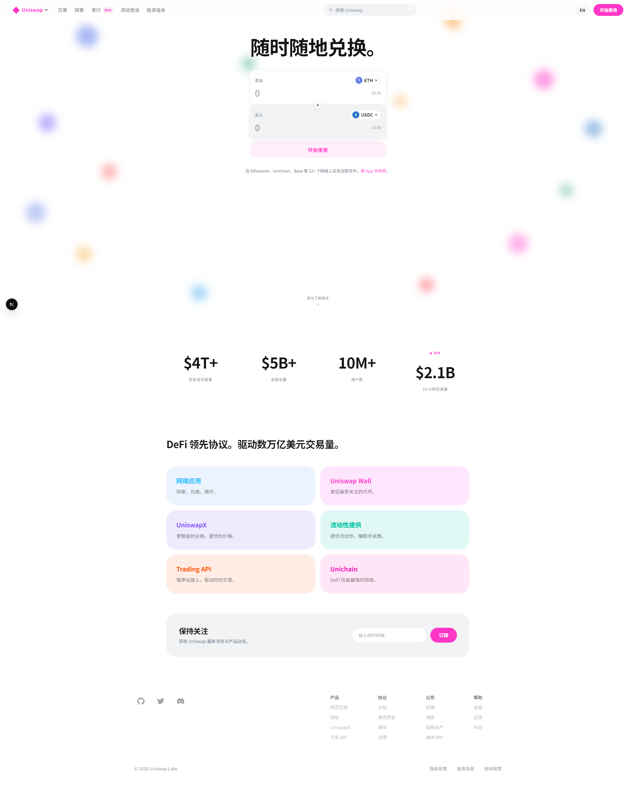

# MasterChef UI

Uniswap-style frontend for testing **MasterChef** smart contract interactions. Built with Next.js 16 + HeroUI v3, mirroring the official [app.uniswap.org](https://app.uniswap.org) 2026 interface — light theme, brand pink `#FF37C7`, stacked Sell/Buy swap panels, blurred token bokeh. UI ships with a zh/en language toggle.

## Screenshot



Homepage details are sampled from the live Uniswap front end (computed styles of the official page): nav links `rgba(19,19,19,0.63)` with pink logo wordmark, `#FF37C7` primary buttons with white text, disabled CTA at 8% pink alpha, per-product accent colors on ecosystem cards.

## Purpose

- Test and verify MasterChef contract functionality through a realistic DeFi UI
- Mirror the Uniswap Web frontend styling/layout with HeroUI + Tailwind v4 components
- No business logic yet — swap quotes and pool tables run on static/mock data

## Features

- Landing page cloned from the current official Uniswap home (light theme + token bokeh background)
- Mock swap card: bidirectional amount input, token dropdown, live price row
- Wallet connect (Wagmi v3: injected / WalletConnect) with connected-state pill
- Pools explorer and Positions pages (mock data, dark theme)

## Tech Stack

- [Next.js 16](https://nextjs.org/docs/getting-started) (App Router, Turbopack)
- [HeroUI v3](https://heroui.com/) + Tailwind CSS v4 + Tailwind Variants
- [Wagmi v3](https://wagmi.sh/) + [Viem v2](https://viem.sh/) for wallet integration
- [next-themes](https://github.com/pacocoursey/next-themes)

## Getting Started

```bash
npm install              # Install dependencies
npm run dev              # Start dev server (http://localhost:3000)
npm run build            # Production build
npm run lint             # ESLint with --fix
```

## Pages

| Route | Description | Status |
|---|---|---|
| `/` | Landing page — official-style light theme | Done |
| `/explore/pools` | Pool explorer table (mock data, dark theme) | Mock |
| `/positions` | LP positions (empty state + top pools sidebar, mock) | Mock |

## Migration Source

Reference implementation: `interface-main/apps/web/src/pages/` (Uniswap Web frontend using Tamagui). Convert Tamagui `styled()` to HeroUI + Tailwind utility classes.

## License

MIT
